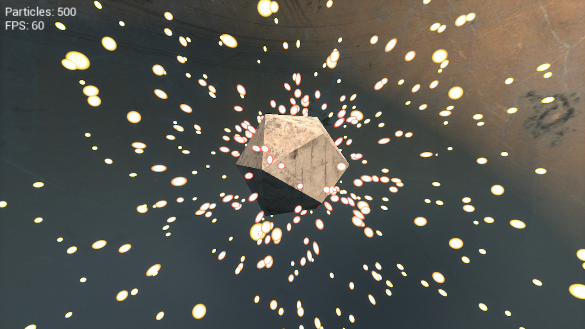
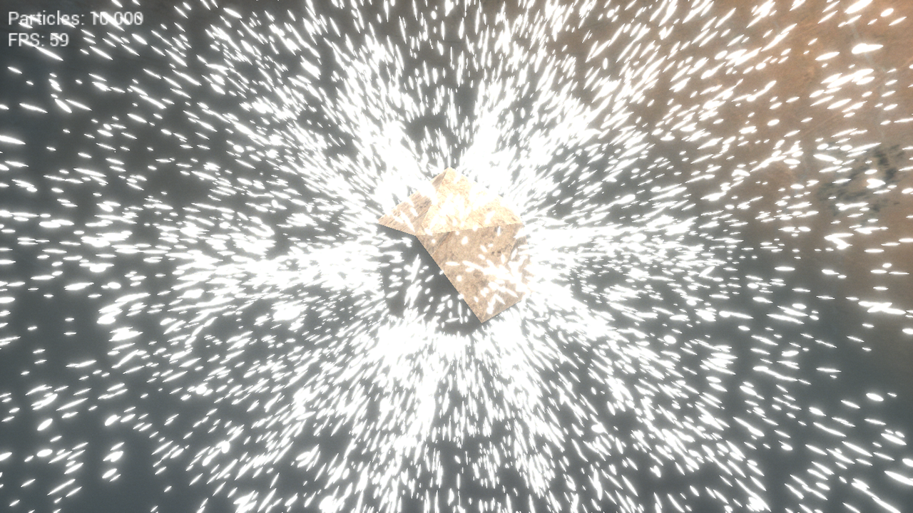

# Unreal GPU Particles

A particle simulation in Unreal Engine using compute shaders. Particles bounce off a rotating D20 object and respawn on an outer sphere.

## Features

- GPU particle simulation and collisions with the D20 object.
- GPU initialization with random positions and velocities on startup and particle-count changes.
- Automatic respawning on the outer sphere when a particle reaches it moving outward.
- Camera-facing particle billboards with velocity-based stretching and scene-depth occlusion.
- Particle colors based on distance to the D20 object's surface.
- Adjustable particle glow, bloom, and film grain.
- On-screen particle count and FPS.

## Requirements

- **Unreal Engine 5.8**.
- A C++ toolchain configured for Unreal Engine on your platform.
- A GPU and graphics API that support compute shaders.

## Run the demo

1. Clone this repository.
2. Generate IDE project files from `Particles.uproject` if needed.
3. Build the `ParticlesEditor` target:
   - **Xcode:** Select the **ParticlesEditor** scheme and **Development** configuration.
   - **Visual Studio:** Select **Development Editor** for your platform.
4. Open `Particles.uproject` with Unreal Engine **5.8** and wait for shaders and assets to finish loading.
5. Click the **Play (▶)** button in the toolbar.

The scene starts with **500 particles**. Select the **Particles** actor in the Outliner to adjust its settings in the Details panel. During Play, select the same actor to adjust runtime settings. Runtime changes are temporary. The camera is fixed, and the D20 object rotates automatically.

## Settings

| Setting | Description |
| --- | --- |
| Particle Count | Number of particles, clamped to 1–1,000,000. |
| Particle Size | Size of the particle billboards, in centimeters. |
| Min Speed / Max Speed | Range of initial particle speeds, in centimeters per second. |
| Velocity Stretch | Stretch the billboards along their movement direction in camera space. |
| D20 Rotation Speed | Rotation speed around the right, up, and forward world axes, in degrees per second. |
| Near Particle Color / Far Particle Color | Colors used near and far from the D20 object's surface. |
| Enable Glow / Glow Color / Glow Intensity / Glow Sharpness | Control the glow within each particle. |
| Bloom Amount / Film Grain Amount | Control the post-processing effects. |

Changing Particle Count recreates the GPU particle buffer and restarts the particles. Changes made during Play are temporary unless explicitly saved back to the editor actor.

## Source files

| File | Purpose |
| --- | --- |
| [ParticleController.h](Source/Particles/ParticleController.h) / [ParticleController.cpp](Source/Particles/ParticleController.cpp) | Particle settings, GPU buffers, D20 collision planes, compute dispatch, and particle rendering. |
| [ParticleCompute.usf](Shaders/ParticleCompute.usf) | Initializes particles, updates their positions, respawns them at the outer sphere, and resolves D20 collisions on the GPU. |
| [ParticleRender.usf](Shaders/ParticleRender.usf) | Creates particle billboards and applies stretching, surface-distance colors, glow, and soft circular edges. |
| [Particles.h](Source/Particles/Particles.h) / [Particles.cpp](Source/Particles/Particles.cpp) | Game mode, player controller, particle count and FPS display, and shader directory registration. |
| [Particles.umap](Content/Particles.umap) | Demo map, camera, lighting, D20 and sphere meshes, post-processing, and particle settings. |

Particle positions and velocities are stored in a GPU buffer. The D20 object's mesh faces are converted to local-space planes at startup for collision checks.
